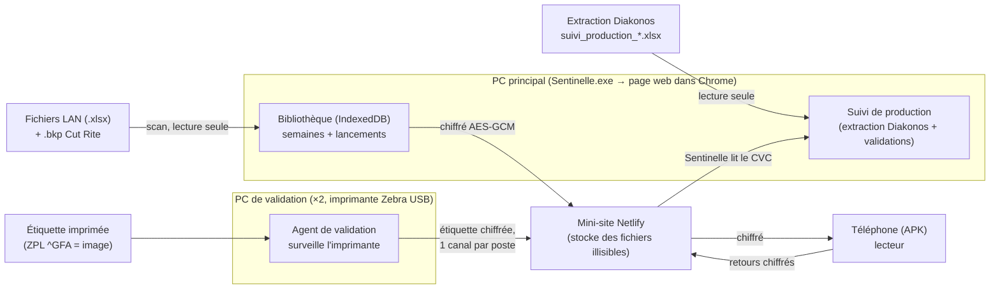

# Sentinelle — dossier technique de reprise

Document destiné à un développeur qui reprend le projet **Sentinelle** (contrôle de coupe
+ suivi de production, Laisné Industrie). Tout le code est dans ce dépôt ; ce document
explique à quoi sert chaque partie, comment on la fabrique, comment les morceaux communiquent,
et où continuer.

> Le dépôt contient aussi `oracle_budget/` (une autre application, sans rapport) et
> `suivi_production/` (une maquette, voir plus bas). Sentinelle = le dossier **`coupe_controle/`**.

---

## 1. Vue d'ensemble

Sentinelle contrôle la découpe de panneaux (cuisines) à partir des fichiers de l'atelier,
et suit l'avancement de la production. Il existe sous trois formes **qui partagent le même
code métier** :

- **PC** : une page web autonome (`coupe_controle/web/index.html`), empaquetée dans un `.exe`
  Windows qui sert la page en local et l'ouvre dans Chrome. C'est le poste principal.
- **Téléphone** : une application Android (`coupe_controle/android/`) qui est un **lecteur**
  de l'état partagé par le PC (plus, depuis la V6.3, quelques retours vers le PC).
- **Mini-site chiffré** (`coupe_controle/lien_telephone/`, Netlify) : relais qui transporte,
  **chiffré de bout en bout**, l'état du PC vers le téléphone (et les retours).

Depuis la **V6.4**, un quatrième morceau : l'**agent de validation**
(`coupe_controle/windows/outils/agent_validation/`), installé sur les PC de validation
(imprimante Zebra), pour le **suivi en direct** (étiquette imprimée = pièce faite).

Version courante : **6.7.1** (le PC et l'APK partagent le même numéro ; l'agent suit).

### Glossaire métier

| Terme | Sens |
|---|---|
| **CVC** | Identifiant d'une pièce dans Diakonos : `CVC` + 8 chiffres (commande), + n° de ligne. La clé d'une pièce = commande + ligne (ligne sur 3 chiffres). |
| **LAN** | Fichier de lancement (`LANssnnPOSTE.xlsx`, 37 colonnes) : les pièces à couper d'un lancement. **Jamais modifié** par Sentinelle (c'est la référence de la prod). |
| **Diakonos** | Le logiciel de gestion de l'atelier (pas « ERP »). On n'y accède **pas** en SQL sans accord du service informatique. |
| **Extraction** | Export Excel « Suivi production » de Diakonos (`suivi_production_JJMMAAAA.xlsx`) : les pièces qui restent à valider. |
| **Bibliothèque** | Base locale (IndexedDB) des semaines et de leurs lancements, scannés dans « Contrôler la coupe ». Source des pièces lancées. |
| **Cut Rite / .bkp** | Logiciel d'optimisation de coupe ; `.bkp` = projet contenant les plans de coupe (`.pct/.ptn/.brd`). |
| **pf** | Petit format (couleur) — géré par l'atelier, pas par Sentinelle. |
| **Casse** | Pièce cassée relancée. Suivie dans la semaine écrite dans le nom du lancement (`LAN2646CASSE` → semaine 46). |

---

## 2. Arborescence (ce qui compte)

```
coupe_controle/
├── sources/                      # SOURCES de travail (à modifier ici)
│   ├── web_src/                  # la page web en morceaux (assemblés ensuite)
│   │   ├── 01_moteur.js          # cœur : lecture LAN, clés de pièces (cleLigne), règles
│   │   ├── 03b_plans.js          # plans de coupe Cut Rite (.bkp)
│   │   ├── 04*_*.js              # contrôles, scan, Diakonos, sommaire, correction
│   │   ├── 06b_bibliotheque.js   # bibliothèque des semaines (IndexedDB) + fichier partagé
│   │   ├── 06d_telephone.js      # LIEN chiffré : code → canal/jeton/clé, envoi au mini-site
│   │   ├── 06g_retour_telephone.js # retour téléphone → PC (canal « retour »)
│   │   ├── 06h_validations.js    # V6.4 : réception des étiquettes validées (canaux « validations »)
│   │   ├── 06i_stock.js          # V6.5 : stock woodStore (brdlib.bdx) + chutes de strat réservées du rapport
│   │   ├── 07_ui.js              # interface (menu, pages), échappement HTML (echapper)
│   │   ├── 07i_suivi_production.js # SUIVI de production (calcul + écran) — gros module (IIFE SUIVI)
│   │   ├── 07j_etiquette_cvc.js  # V6.4 : décode l'étiquette Zebra (ZPL ^GFA) et LIT le CVC
│   │   ├── 08_style.css, 08a_polices.css, 09_body.html
│   ├── outils/                   # fabrication + TESTS
│   │   ├── assembler_web.py      # assemble web_src/ → web/index.html (porte la version)
│   │   ├── test_web*.js          # tests Playwright (navigateur réel)
│   │   ├── fabriquer_etiquette_test.py  # fabrique une fausse étiquette ZPL (test, anonyme)
│   └── LISEZMOI.md
├── web/                          # page ASSEMBLÉE + PWA (manifest, sw.js, icônes)
│   └── index.html                # LIVRÉE (générée par assembler_web.py — ne pas éditer à la main)
├── android/                      # application téléphone (Gradle, Java, Robolectric)
│   └── app/src/main/java/com/marinedouyere/sentinelle/*.java
├── windows/                      # lanceur .exe (Go) + ressources
│   ├── main.go, fenetre_windows.go, reseau.go, fabriquer.sh, ressources.py
│   └── outils/
│       ├── agent_validation/     # V6.4 : AGENT des PC de validation (Go)
│       └── detecteur_etiquette/  # outil d'essai (capture d'une étiquette Zebra)
├── lien_telephone/               # mini-site Netlify (relais chiffré)
│   └── netlify/functions/partage.mjs
├── claustra/                     # logiciel à part (fichier de lancement des claustras)
└── DOSSIER_TECHNIQUE.md          # ce fichier
```

`coupe_controle/web/android/` est une **ancienne** variante (ignorer) ; l'appli courante est
`coupe_controle/android/`.

---

## 3. Architecture et flux



### Le lien chiffré (PC ↔ téléphone ↔ agents)

Tout passe par le **mini-site** `https://sentinelle-laisne-0ysi8zpn.netlify.app/api/partage`.
Le site ne voit que des octets chiffrés. Le **code de liaison** (16 caractères, ~80 bits,
alphabet sans O/0/I/1) n'est **jamais** envoyé.

À partir du code `n` (normalisé majuscules + alphanumérique) :

- **canal** (où est le fichier) = `SHA-256("<but>:" + n)` → 32 hex.
  - fichier partagé : but `sentinelle-canal` → `06d_telephone.js` (`sentinelle-canal:n`).
  - retour téléphone : but `sentinelle-retour`.
  - validations poste P : but `sentinelle-validations:P` (P = 1..4).
- **jeton d'écriture** = `SHA-256("sentinelle-ecriture:" + n)` (le 1ᵉʳ écrivain d'un canal le fixe).
- **clé** = PBKDF2-HMAC-SHA256(mot de passe = `n`, sel = `sentinelle-laisne-industrie`,
  150 000 itérations, 32 octets) → AES-256-GCM.
- **paquet** = `"SNT1"` (4) + IV (12) + chiffré AES-GCM (avec le tag). Le contenu peut être gzip.

L'API (`partage.mjs`) : `GET ?canal=` → manifeste ; `GET ?canal=&version=&partie=i` → octets ;
`PUT …` (en-tête `X-Sentinelle-Jeton`) dépose une partie ; `POST ?canal=` publie le manifeste
et efface l'ancienne version. Taille par partie ≤ 5 Mo, ≤ 60 parties.

### Le fichier partagé (PC → téléphone)

`contenuFichierPartage()` (`06b_bibliotheque.js`) : `{ format, genere, par, colonnesPieces,
explications, semaines[], suiviProduction, retourTelephone, retourValidations }`.
Envoyé au canal « fichier » dès qu'il change (signature comparée). Le téléphone le lit.

### Le suivi en direct (V6.4, le point délicat)

Diakonos imprime l'étiquette d'une pièce **en image** (ZPL `^GFA`, compressé Z64 = zlib+base64) :
pas de texte, pas de code-barre exploitable. La chaîne :

1. **Agent** (`agent_validation/`, Go, sur le PC de validation) : surveille le dossier spool
   Windows (`C:\Windows\System32\spool\PRINTERS`, avec « conserver les documents imprimés »).
   À chaque nouvelle étiquette, il la met en file, la chiffre (même format SNT1 que le lien) et
   la **dépose sur son canal** (`sentinelle-validations:<poste>`). File locale + accusés.
2. **Sentinelle** (`06h_validations.js`) : interroge les canaux des postes (1..4) toutes les 8 s,
   déchiffre le lot, et pour chaque étiquette appelle `lireCvcEtiquette` (`07j`).
3. **Lecture du CVC** (`07j_etiquette_cvc.js`) : décode l'image `^GFA`, repère la ligne du CVC,
   lit les 8 chiffres **un par un** (police à pas fixe ; gabarits dessinés au canvas), puis
   **choisit la commande lancée** qui colle le mieux (recoupée avec la bibliothèque). Une lecture
   douteuse est **écartée** (jamais une mauvaise pièce). Renvoie `{ commande, ligne, cle, … }`.
4. **Intégration au suivi** (`07i`, dans `calculer`, depuis la 6.4.3) : **une étiquette = une pièce**.
   Pièces faites = ce que dit la dernière extraction **+ les étiquettes imprimées après elle**
   (`etiquettesEnDirect(heure de l'extraction)`), plafonné à la quantité de la ligne. L'heure d'une
   étiquette = son heure d'impression (l'agent la met dans l'identifiant `poste-secondes-compteur`).
   - **Dévalidation** : une étiquette d'avant l'extraction ne compte plus — l'extraction fait foi.
   - **Ré-impression** : compte, plafonnée à la ligne, corrigée par l'extraction suivante.
   - **Casse** : c'est l'extraction qui décide (Diakonos remet une pièce relancée « en cours »). Ne pas
     se fier à la date `maj` d'un lancement : elle est réécrite à chaque relecture de la semaine (une
     tentative 6.4.3 basée dessus passait toute la casse « à faire », corrigée en 6.4.4).
   - Un lancement hors extraction n'est suivi que par ses pièces étiquetées (le reste : à faire).
   Les étiquettes prises sont accusées dans le fichier partagé (`retourValidations.traitees`) pour que
   l'agent arrête de les renvoyer. Test autonome : `sources/outils/test_web_comptage.js`.
5. **Pièces de Diakonos hors lancement** (6.4.4) : les pièces de production de l'extraction qui ne sont
   dans aucun lancement de la bibliothèque (lancement pas scanné, pièces ajoutées après) forment une
   ligne « Pas dans un lancement » (poste « Diakonos ») par semaine Diakonos, avec le coloris de
   l'extraction (« Code Coloris », 11e case des lignes). Contrôle : « à faire » du suivi = somme
   « Qte en cours » de production de l'extraction (`test_web_suivi.js`).

Activité par poste et bouton « Réinitialiser » : `htmlBandeauValidations()` (06h) + `brancher()`
(07i). Chaque poste a un **nom** (ex. « Crédences ») envoyé dans son lot.

### Le stock des panneaux (V6.5, `06i_stock.js`)

- **Source** : `brdlib.bdx`, la bibliothèque de panneaux de woodStore, **extraite à la main** par
  l'atelier (lecture seule, aucun accès SQL). CSV en windows-1252, 20 colonnes. Utiles :
  0 code (commence par `X` = chute), 1 quantité, 2 matériau, 3-5 longueur/largeur/épaisseur,
  **7 Limite** (code woodStore : **0** = limité au stock, **9** = dépassement autorisé),
  9 désignation, 10 fil, **14 statut** (0 panneau entier, 1 chute disponible, **2 chute réservée**
  pour un lancement à débiter), 15 emplacements `case(qté) case(qté)` (liste parfois coupée par
  woodStore : la dernière parenthèse peut manquer), 17 famille.
- **Règle** : stock réel = stock − réservé. Les chutes réservées sont comptées et listées à part.
- **Liste (6.5.8)** : tous les matériaux par défaut, même à zéro (cas du 1136 à zéro, seul le 1136-PF en stock : il
  n'apparaissait pas). La case « avec du stock seulement » n'est plus cochée d'office ; cochée, un code tapé en
  entier s'affiche quand même.
- **Panneaux entiers réservés (6.5.7)** : woodStore range les panneaux entiers réservés pour un lancement
  dans la **case 302** (`CASES_RESERVATION`). Cas réel du 12/11 : 1063 = `302(3) 1042(21) 1043(24)` = 48
  en stock, **45** disponibles. Par format : `reserve` (case 302, jamais plus que la quantité) et
  `dispo` = qté − réservés ; par matériau : `nbEntiers` = disponibles, `nbEntiersReserves` à part. Le
  fichier partagé garde la quantité totale (index 1) et les cases (index 11) : le téléphone refait le même
  calcul (`FormatStock.reserve()` / `dispo()`), donc aucun changement de format.
- **Page Stock** (menu) : charger le fichier (gardé en mémoire du navigateur, `sentinelle-stock`),
  rechercher un matériau, détail (entiers, chutes disponibles, chutes réservées, cases, Limite),
  « chutes qui dorment » (> 120 jours), tri par clic sur les en-têtes de colonnes. Avertit si les
  données ont plus de 7 jours.
- **Téléphone** (6.5.1) : le stock part dans le fichier partagé, **déjà lu** (`stockPourPartage()`, une
  ligne par format : code, qté, matériau, L, l, ép., limite, désignation, fil, réservée, famille, cases,
  origine, depuis). Charger un nouveau fichier déclenche l'envoi (`signatureStock()` dans la signature
  d'envoi). Écran `EcranStock.java` (icône « panneaux empilés » de la barre du haut : le menu du bas est
  plein, 5 onglets au plus) : même contenu que le PC, tri par les en-têtes.
- **Rapport du lancement** : page « Chutes de stratifié réservées » (`partieChutesStratReservees`).
  Les chutes viennent des plans du `.bkp` du lancement (plans « chute du stock »), **stratifié
  seulement** (matériau `STRAT…` ou épaisseur ≤ 1,2 mm ; ni agglo ni compact). La **case** est lue
  dans le `.bkp` (lignes BRD3, relevées par woodStore à l'optimisation), à défaut dans le fichier de
  stock. Colonnes : case, couleur, désignation, longueur, largeur, quantité ; triées par case.
  Seules des **chutes** y figurent : les feuilles entières (dont RCB / RCB-CRED14) n'y sont pas, les
  chutes de RCB restent.
- **À venir** : simuler un lancement complet sur le stock.

### Vérifier un pré-lancement (V6.6, `06j_pre_lancement.js`)

- **Source** : la grille de l'écran « Lancement » de Diakonos exportée en Excel, une ligne par pièce, **19 colonnes sans
  en-tête** : Qté à lancer, Semaine (livraison), Commande, Ligne, Catalogue, Article, Désignation, Qte, Longueur,
  Largeur, Epaisseur (cotes finies), Code coloris, Coloris, Cp, Ville, com_transporteur, Transporteur, Blocage compta,
  Blocage fab. Un export avec une ligne de titres est lu par le nom des colonnes. Gardé en mémoire
  (`sentinelle-pre-lancement`). Page « Vérifier un pré-lancement » du menu (sous « Préparer un lancement »).
- **Contrôle avant lancement** : bloquée compta / fab, en double, qté à lancer > commande (rouge) ; **déjà lancée**
  (clé commande+ligne dans la bibliothèque, avec le lancement et la semaine), en retard (semaine < celle du
  pré-lancement) (orange) ; en avance, lancée en partie, à 0 (info) ; **plus grande que les panneaux en stock** (rouge :
  formats en stock ou Limite 9, chutes disponibles ; cas réel du 1136, pièces de 3 449 mm, seul le 2790 × 2060 en stock,
  le 4110 × 2060 à 0). La semaine du pré-lancement = celle du plus de pièces.
- **Ce que devient un article à la coupe** (matière d'âme, couches, dessous) : 1) **cas particuliers** saisis dans la
  page (`sentinelle-cas-particuliers` ; par défaut RENF391001 = 2 panneaux SMELBLALIS19 19 mm, un seul stratifié
  dessus, débit + 10 mm — à la main il faut mettre 2 agglos dans la liste de coupe) ; 2) **appris** dans la
  bibliothèque, (article + coloris) puis article : colonne « agglo », coloris_inf (rien / RCB… / décor = même décor),
  couches = épaisseur finie / épaisseur de la matière ; 3) règles par désignation et épaisseur, marquées « supposé ».
- **Simulation** : par matériau (décor dessus et son « -PF », âme, dessous), surface des pièces × m² de stock pris pour
  1 m² de pièces, **mesuré** sur les lancements de la bibliothèque qui ont leurs plans (panneaux entiers et chutes du
  stock, pas les modules ; mesuré en 2026 : stratifié ≈ 2,1, agglo ≈ 1,6, contrebalancement ≈ 1,9 ; défauts 2,0 / 1,55
  / 1,8). Comparé au **stock réel** (sans chutes réservées ni case 302) : OK (≤ 85 %), juste, il manque ≈ N panneaux
  (rouge si Limite 0 « Cut Rite ne pourra pas tout placer », orange si Limite 9 « à commander »), pas dans woodStore.
  C'est une estimation : l'optimisation réelle reste celle de Cut Rite.

### Rapport du lancement : strats par code croissant (V6.7.1)

La page « Strats : panneaux et restes » range les codes en ordre croissant, les nombres comme des nombres (891, 941,
975, 982, 1047-PF, 1049…) puis les codes en lettres (RCB…) ; Cut Rite les trie comme du texte (891 à 982 après 1138).
`ordreCodeStrat` dans `04d_sommaire.js`.

### Suivi : pièces « Pas dans les lancements » (V6.7.2, `07i_suivi_production.js`)

Dans Suivi de production (PC, extraction chargée sur le poste), une carte liste chaque pièce de **production** de la
dernière extraction Diakonos (Qte en cours > 0) qui n'est dans **aucun fichier de lancement** de la bibliothèque, plus
le surplus d'une pièce lancée quand Diakonos en a plus en cours que le lancement (« en plus du lancement »). Mêmes
nombres que les lignes « Pas dans un lancement » des barres. Fournitures, Dibond et résine ne sont pas listés : ils ne
passent jamais par les fichiers de lancement. Puces par semaine de livraison, recherche, et export Excel au format du
fichier de suivi : `lignesExtraction` garde la ligne brute et l'en-tête du fichier (index 11 et 12), l'export les
recopie tels quels, lignes en jaune. Le calcul remplit `etat.horsDetail` ; affichage `htmlHors`, export `exporterHors`.
Contrôlé sur l'extraction du 12/11/2026 et les 7 lancements S48 : 15 lignes, 78 pièces, comme le relevé à la main.

**V6.7.3 : compter des pièces à la main dans un lancement.** Dans cette liste, on coche des lignes, on choisit un
lancement de la bibliothèque, « Compter dans ce lancement » : Sentinelle ajoute ces pièces à celles du lancement pour
tout le suivi (barres, vues, résumé du téléphone : champ `aj` = pièces ajoutées). **Le fichier LAN n'est jamais
modifié.** Les ajouts sont gardés dans `localStorage` (`sentinelle-suivi-rajouts` : semaine de la bibliothèque `sid`,
`cleNomLancement`, pièce `cleLigne`, quantité) et appliqués dans `calculer()` juste après la lecture des lancements. Une
pièce entière : quantité = max(Qte lancement, Qte en cours) de Diakonos ; une ligne « en plus du lancement » : le
surplus. Si la pièce ajoutée entière arrive ensuite dans un vrai fichier de lancement, l'ajout ne compte plus (pas de
double compte, signalé dans la liste « Pièces ajoutées à la main », où « Retirer » annule). Premier cas réel :
CVC26100844 (5 pièces F206-ST9) comptée dans LAN264801START.

**V6.7.5 : nouveau lancement nommé par l'utilisateur.** Dans la même liste, « + Nouveau lancement (nom au choix)… » :
nom, semaine (par défaut celle des pièces cochées) et poste (Chantiers par défaut). Le lancement est rangé dans la
**bibliothèque** comme un lancement scanné (`archiverLancements`, fiche avec `manuel: true`, `dossier: "Créé dans
Sentinelle"`, pas de fichier, pièces au format `COLONNES_PIECES_BIBLIOTHEQUE` depuis la ligne de l'extraction) : il
compte comme un lancement normal partout (suivi, vues, validations, recherche, fichier partagé et téléphone). On peut
ensuite y ajouter d'autres pièces (choisi dans la liste), retirer une pièce ou supprimer le lancement
(`retirerLancementBibliotheque`, retrait daté). Un nom déjà pris dans une autre semaine est refusé. Une ligne « en plus
du lancement » (surplus) va toujours dans le lancement qui a déjà la pièce : sinon la règle des pièces relancées (une
pièce ne compte que dans le lancement le plus récent qui l'a) fausserait le décompte. Aucun fichier LAN n'est créé ni
modifié.

### Coller des lignes et lancements hors dossiers (V6.8.2)

**Coller des lignes.** Dans « Pas dans les lancements », « Coller des lignes » : des lignes copiées de Diakonos ou
d'Excel (commande, ligne, catalogue, article, désignation, longueur, largeur, épaisseur, quantité, code coloris,
coloris ; tabulations) pour des pièces qui ne sont pas dans l'extraction. Cas réel : Trigano (articles TRI-…), lancé
hors du chemin standard (fichiers LAN26xxTRIGANO rangés dans d'autres dossiers). Les lignes (`etat.collees`,
`localStorage` `sentinelle-suivi-collees`) s'ajoutent à la liste (puce « Collées »), à cocher puis mettre dans un
lancement (nouveau ou existant), comme les autres. Une ligne déjà dans l'extraction ou dans un lancement n'est pas
ajoutée (dit dans le message). Règle de l'atelier inchangée : une pièce collée dans le suivi de production est à faire,
absente du suivi elle est faite. Le lancement créé garde la liste de ses pièces collées (`collees`) : « Retirer » les
remet dans la liste. Export Excel : les lignes collées dans les colonnes de l'extraction.

**Lancements hors dossiers.** « La semaine » et « Contrôler la coupe → Semaine NN » ne montraient que les cases (fichiers
des dossiers de la semaine). `lancementsHorsCasesDeLaSemaine` y ajoute les lancements de la bibliothèque de cette
semaine qui ne sont dans aucune case : créés dans Sentinelle, ou ajoutés à la bibliothèque depuis un autre dossier.
V6.8.3 : ces lancements comptent aussi dans le récapitulatif du bas de la semaine (`avecHorsCases` : prévues, total,
doublons entre lancements ; pas de .bkp ni de contrôle) et dans le compte rendu de la semaine (`donneesCompteRendu`).

### Refonte de l'interface (V6.9.0)

Demande : « pas ergonomique, trop chargé, on se perd, actions mal placées ». Même logique sur le PC et le téléphone.

- **Menu** (PC) : plus compact, tout tient dans 900 px de haut (« Expérimental » sans défiler).
- **« ? »** (`boutonAide` / `texteAide` dans `07c_accueil.js`, `Ui.texteAide` / `Ui.titreEtAide` sur Android) : les
  explications sont cachées derrière un petit « ? » à côté du titre. Le texte reste dans la page (attribut `hidden`).
- **Contrôler la coupe** : une ligne pour le dossier (semaine, dossier ouvert, boutons) ; le compte rendu du scan dans
  un cadre de 5 lignes qui défile (« Tout voir » le déplie) ; à gauche la liste des lancements (état en pastille), à
  droite **un seul lancement** (`vueControle()`, `caseChoisie`, `appliquerVueControle` dans `07_ui.js`). « Tous » remet
  toutes les cases les unes sous les autres (choix gardé : `localStorage["sentinelle-vue-controle"]`). Dans la case :
  l'état dans l'en-tête, les fichiers sur deux colonnes, une seule barre d'actions (GO, Vérifier Scies, Rapport,
  Problèmes, Plans de coupe). Les cases restent toutes dans la page (`.cachee-vue`), les tests du contrôle passent en
  « Tous » (`addInitScript`).
- **Suivi de production** : boutons de l'extraction en haut de page, « Compter » visible, puis des **onglets**
  (`PANNEAUX`, `etat.panneau`, `localStorage["sentinelle-suivi-panneau"]`) : Avancement par lancement, Par semaine /
  transporteur…, Pas dans les lancements (avec le nombre), Tableau Excel, Extractions. Seul l'onglet choisi est
  dessiné. Pas dans les lancements : en-tête du tableau qui reste visible en descendant. Téléphone : mêmes onglets
  (`panneauSuivi`, `ongletsSuivi`).
- **Stock** : recherche et en-tête du tableau collés en haut en descendant ; le détail du matériau cliqué s'affiche à
  droite et reste visible (`.stk-colonnes.avec-detail`). La liste reste complète (aucune limite).
- **Bibliothèque** : semaines gardées à gauche, fichier partagé et téléphone à droite ; « + Ajouter les semaines
  d'avant » en haut.
- **Recherche** : « Avec l'étiquette » et « Pièce sans étiquette » côte à côte, résultats dessous.
- **La semaine** : carte courte pour un lancement pas encore préparé ; « À regarder » plus serré.

Test : `test_web_interface.js` (menu, un lancement à la fois, « Tous », compte rendu du scan, onglets, « ? », en-tête
collé, stock à droite, bibliothèque, recherche, pas de défilement de côté à 1000 px).

**Téléphone, V6.9.1** (la 6.9.0 changeait trop peu l'appli) :
- Menu du bas : Semaine, Contrôle, Recherche, Suivi, **Plus** (`ONGLET_PLUS`, `Ecran.PLUS`, `ecranPlus`) : grandes
  tuiles Plans de coupe, Stock des panneaux, Claustras, Lien avec le PC (`dansPlus` garde « Plus » en avant). Barre du
  haut : plus de petites icônes ; « Relier au PC » / « ● Relié » (`majEtatLien`) et Actualiser.
- Semaines en pastilles S45 S46 S47 S48 (`pastillesSemaines`, la plus ancienne à gauche, « Toutes ▾ » au-delà de 4).
- Contrôle : une rangée « Tous » + un bouton par lancement (état en couleur, `pastillesLancements`) ; un lancement
  affiché seul et ouvert (`lancementChoisi`, `carteLancement(l, n, true)`), précédent / suivant en bas ; « Tous » :
  le tableau de la semaine et le compte rendu (.pdf). Bilan : les contrôles bons sur une ligne « ✔ OK : … », ceux pas
  faits sur une ligne « Pas vérifié : … », seuls les problèmes en entier.
- La semaine : chiffres en grandes tuiles (2 par ligne). « Bibliothèque des semaines » s'appelle « Lien avec le PC ».

**V6.9.2 : bandeau des semaines partout** (retour : « le bandeau semaine par semaine, c'est pas mal » ; « la liste
des semaines du suivi est mal organisée ») :
- PC : le menu n'a plus les quatre entrées « Semaine NN » ; une seule entrée « Contrôler la coupe »
  (`data-onglet="controle"`, `ongletControleParDefaut` : la dernière semaine contrôlée, sinon celle du calendrier).
  Les quatre semaines sont dans un bandeau (`htmlBandeauSemaines`, `brancherBandeauSemaines` dans `07_ui.js`) en haut
  de La semaine et de Contrôler la coupe : semaine, dates, « ⚠ n » à regarder ou « ✔ », « vide ». Dans Contrôler la
  coupe, les boutons du bandeau gardent `.onglet-btn[data-onglet=paire…]` (les tests cliquent d'abord
  `.menu [data-onglet="controle"]`).
- Suivi (PC et téléphone) : l'avancement par lancement a son bandeau des semaines (S40… S48, % et état de chacune,
  `htmlBandeauSuivi`, `etat.semaineSuivi` ; téléphone `bandeauSuivi`, `semaineSuivi`) ; une seule semaine affichée,
  au départ celle en fabrication ; « Toutes » les remet les unes sous les autres.
- Téléphone : les bandeaux de semaines (Semaine, Contrôle, Suivi) vont de la plus récente à la plus ancienne
  (demande : « logique de semaines décroissantes ») ; le bandeau ne défile que si la semaine choisie dépasse à droite.
- V6.9.3 : le Suivi de production (PC et téléphone) va **toujours** de la semaine la plus récente à la plus ancienne :
  bandeau, « Toutes », vue « Par semaine » (et le détail par semaine des autres vues), colonnes du tableau Excel (le
  total reste à la fin), « Pas dans les lancements » (pastilles et lignes). Seul l'affichage change (`decroissantes`) :
  le résumé et le fichier partagé gardent leur ordre.
- V6.9.4 : le nombre de pièces de chaque semaine est affiché (pas seulement le %) : bandeau, en-tête de la semaine,
  vues (`totalSemaine` = faites + à faire + pas suivies ; vues : faites + à faire) ; téléphone : pastilles sur deux
  lignes « S47 · 68 % / 933 pièces », en-tête de la semaine, `chiffresGroupe` (« 21 pièces · 18 faites · 3 à faire »).

### Semaine retirée puis rescannée (V6.7.4, `lancementsActifs` dans `06b_bibliotheque.js`)

« Retirer la semaine » vide ses lancements et pose `supprimeeLe` (date du retrait), gardée pour la fusion entre PC :
`fusionnerSemaines` n'efface que les lancements plus anciens que le retrait. Une semaine rescannée après coup a donc
`supprimeeLe` ET des lancements valables. Le suivi, les validations, les plans du fichier partagé et l'archivage des
lancements manquants sautaient toute semaine marquée : cas réel, semaine 46 retirée le 01/11 à 21:06:54 et rescannée
20 s plus tard, ses 9 lancements absents du suivi (pièces en « Pas dans un lancement »). Partout, on lit maintenant
`lancementsActifs(s)` : les lancements scannés après le retrait. Test : `test_web_semaine_retiree.js` (autonome).

### Claustras : saisie automatique depuis les confirmations de commande (V6.7, `06k_claustras.js`)

- **Source** : les confirmations de commande (PDF) d'un dossier (« Lire un dossier de confirmations… », sous-dossiers
  compris) ou des PDF choisis. Une ligne de commande est un claustra si son bloc parle de « claustra » (« Réalisation
  d'un claustra en aggloméré stratifié double face ») ; les autres lignes (îlots, plans…) sont comptées et laissées aux
  lancements habituels.
- **Lecture** : texte du PDF (pdf.js) ; s'il n'y en a pas — PDF « Microsoft Print to PDF », où le texte est dessiné —
  la page est rendue à 300 dpi et lue par **Tesseract** (tesseract.js 7, cœur simd-lstm, modèle `fra`), fichiers
  dans `web/ocr/` (≈ 5,3 Mo), copiés dans le .exe par `fabriquer.sh` et chargés seulement à ce moment-là
  (`main.go` sert `.js` en `text/javascript` : un worker refuse `text/plain`). Environ 3 s par page. Les mots
  gardent leur position : l'en-tête est lu dans la **moitié gauche** (la droite porte l'adresse du client sur les
  mêmes lignes).
- **Champs lus** : commande (CVC + 8 chiffres), référence, code client, représentant, transporteur, semaine/année
  de livraison ; par claustra : ligne, quantité (colonne QTE), coloris (code + nom), épaisseur, longueur et hauteur
  totales, lames droites / obliques et leurs largeurs, épaisseur des lames, profondeur des lisses, emballage et
  montage (inclus / non inclus). Agglo d'après l'épaisseur (29 → SAG28HYBR, 39 → SAG38HYBR, 21-22 → SAG19HYBR).
  Tout est modifiable à l'écran et gardé en mémoire (`sentinelle-claustras`).
- **Fichier de lancement** : règles du logiciel Claustra (lisses, lames hauteur − 60, surcote 25, idPlan C, CBD,
  chants PVC, A MONTER / ENKIT, protections), quantités × nombre de claustras, `trans_nomcourt` = transporteur.
  Un nouveau classeur (nom par défaut `LAN{AA}{SS}CLAUSTRA`) : aucun fichier existant n'est modifié.
- **Plan du claustra** (`svgPlanClaustra`) : vue de face et côté (1:20 en général), vue de dessus (1:5), cotes et
  pièces ; imprimable en A4 paysage. Les lames sont dessinées à espaces égaux, bouts compris (supposé : la
  confirmation ne donne pas leur position).
- Test : `test_web_claustras.js` (confirmation fabriquée ; vraie confirmation en image avec
  `SENTINELLE_CLAUSTRA_PDF`, donnée client hors dépôt).

### Claustras : largeur lame par lame et photo du plan (V6.8)

**Largeurs.** Une confirmation peut dire « 1 lame droite / 8 lames obliques », « Largeur des lames : 80 et 77 mm »
sans dire quelles lames font quoi : seul le plan le dit (cas réel CVC26100433). `lireBlocClaustra` garde alors les deux
largeurs (`largeursLames`) sans deviner. Les lames se saisissent en lignes `{ sorte: droite | oblique, nombre, largeur }`
(`lamesDe(c)` : les lignes saisies, sinon celles tirées de la confirmation), plusieurs largeurs possibles pour une même
sorte (ex. 6 obliques à 77 + 2 à 80). Tant qu'une largeur manque : « À compléter : largeur … (voir le plan : 80 ou 77
mm) », pas de fichier. `avertissementsLames` signale (sans bloquer) un nombre différent de la confirmation ou une largeur
qui n'y est pas. Pièces, plan SVG et fichier de lancement sont faits à partir des lignes. Chaque confirmation gardée
porte la version de lecture (`LECTURE_CL`) : une confirmation lue par une version plus ancienne est relue.

**Photo du plan.** Sur le téléphone : icône appareil photo en haut → écran Claustras (`EcranClaustras.java`) : les
commandes claustras lues sur le PC (champ `claustras` du fichier partagé, `claustrasPourTelephone()`) ou un n° tapé ;
« Photo du plan » (appareil photo : `TakePicture` + `FileProvider` `${applicationId}.photos`, autorisation CAMERA
demandée) ou « Choisir une photo » (galerie). `PhotoPlan.preparer` remet la photo à l'endroit (EXIF), la réduit à
2400 px au plus, en JPEG 85. Elle attend dans `files/photos_plan/` ; `DemandesPc` l'envoie au PC dans une demande
`photoClaustra` (image en base64, canal retour chiffré, comme les plans modifiés) et l'efface quand le PC a répondu. Le
PC (`photoClaustraDuTelephone`, appelé par `traiterDemandesTelephone`) vérifie le n° CVC et que c'est un JPEG/PNG de
moins de 12 Mo, la range dans IndexedDB (`sentinelle-claustras-photos`, par commande) et l'affiche à droite de la
saisie des lames (visionneuse : taille réelle, tourner). On peut aussi ajouter une photo depuis le PC. Une photo reçue
avant la confirmation attend dans « Photos de plan sans confirmation lue ».

### Lien PC → téléphone : savoir si le téléphone suit (V6.5.1)

Cas réel du 11/11 : le PC envoyait sur un **nouveau code**, le téléphone lisait toujours l'**ancien**
(dernière version : mardi) et ne disait rien. Trois parades :
- **Accusé de lecture** : après chaque nouvelle version lue, le téléphone dépose dans le canal retour
  `lectures: { appareil: { version, genere, quand } }` (`DemandesPc.lu / accuseAEnvoyer`, fusion avec un
  autre téléphone). Le PC le note par code (`noterLecturesTelephone`, `sentinelle-lectures-telephone`) et
  la carte Téléphone dit : « a bien reçu le dernier envoi », « n'a pas encore ouvert le dernier envoi »,
  ou « Aucun téléphone n'a encore lu ce code » (→ rescanner le QR code). Le PC garde la `version` publiée.
- **Code remplacé / envoi arrêté** : « Nouveau code » et « Arrêter » font un dernier envoi sur l'ANCIEN
  code avec `lien: "remplace"` / `"arrete"` (`prevenirAncienCode`). Le téléphone affiche un bandeau rouge
  sur tous les écrans, avec « Scanner le nouveau QR code du PC ».
- **Date des données** : l'écran Semaine du téléphone affiche « Données du PC du … ».
Le téléphone suit **un seul PC** : celui dont il a scanné le QR code.

**Le code tient (6.5.2)** : `Sentinelle.exe` garde le code dans `%LOCALAPPDATA%\Sentinelle\lien-telephone.json`
(route locale `/sentinelle/lien`, en-tête `X-Sentinelle: lien` obligatoire, `windows/memoire.go`, test
`memoire_test.go`). La page y recopie le code à chaque changement (`garderCodeDansLExe`) et le reprend au
démarrage si la mémoire de Chrome l'a perdu (`restaurerLienTelephone`, puis envoi). Sur la carte Téléphone,
« Reprenez son code » : on tape le code affiché dans l'appli (en gros sur la carte « Lien avec le PC ») et le PC
reprend ce code — le téléphone et les PC de validation n'ont rien à refaire (`reprendreCodeLienTelephone`).
« Créer un code » n'est que pour un premier téléphone. Test : `test_web_lien_tient.js`.

**Plusieurs PC sur le même code (6.5.3)** — cas réel du 12/11 : un PC au bureau et un PC à la maison, chacun
sa bibliothèque ; le téléphone ne voyait que celle du dernier PC qui envoyait. Désormais, avant chaque envoi et
toutes les 2 minutes, le PC relit le site (`reprendreDuSite`, `synchroniserAvecLeSite`) : si un AUTRE PC a publié
(version ≠ la sienne), ses semaines sont fusionnées (`fusionnerSemaines`, comme le Drive), avec son suivi
(`SUIVI.recevoir`) et son stock s'il est plus récent (`recevoirStockDistant`). Le prochain envoi contient les
lancements des deux PC. Le fichier partagé porte le nom du PC (`poste`, donné par `Sentinelle.exe` :
route `/sentinelle/poste`) ; l'appli affiche « Données du PC « X » du … ».

**Suivi : semaines de LIVRAISON (6.5.6)** — en semaine 46 du calendrier, on fabrique la livraison 47 : c'est la
semaine « en fabrication » (`resume.fabrication`, calendrier + 1) ; une livraison d'avant pas finie est en retard
(`ordreFab`). Les vues par semaine / transporteur / coloris / client rangent chaque pièce dans sa semaine de livraison
Diakonos (`livraisonCle`, colonne Semaine de la dernière extraction qui l'a), comme Diakonos ; une pièce sortie de
toutes les extractions garde la semaine de son lancement. Cas réel : JMC semaine 46 absente côté téléphone.
Noms de **Diakonos** dans les vues : transporteur Diakonos de la pièce (sinon de sa commande) ; pour une pièce déjà
faite, le nom du fichier de lancement ramené au nom Diakonos connu (`versDiakonos` : « LOG 4 T1 » → « LOG 4 T1
LAISNE ») ; une « dimension » en guise de transporteur (colonne décalée) est ignorée. Coloris : code Diakonos.
**Surplus** : si Diakonos a plus de pièces en cours que le lancement (pièce relancée, relance dans aucun lancement
scanné), le surplus va « à faire » dans « Pas dans un lancement » de sa semaine de livraison (`L.surplus`, ajouté dans
les totaux). Contrôle permanent : `test_web_suivi_diakonos.js <index> <extraction[+…]> <dossiers semaine…>` —
pièce par pièce, transporteur × semaine, semaine, coloris × semaine et tableau identiques à Diakonos (vérifié sur
les extractions réelles du 07/11, 10/11 et 12/11 : 0 écart). Les pièces d'un lancement comptent quel que soit leur
catalogue Diakonos (ex. Dibond d'un lancement chantier) ; hors lancement, la production seulement.

**Tout lancement des cases entre dans la bibliothèque (6.5.5)** — cause réelle du lancement du 10/11 absent du
téléphone : il était dans sa case sur le PC, mais un lancement n'entrait dans la bibliothèque (donc dans le fichier
envoyé) qu'après « Lancer les contrôles » de toute la semaine, un scan de dossier ou une validation. Le contrôle d'une
case seule et un fichier mis à la main ne l'y mettaient pas ; une semaine introuvable l'écartait sans message.
Désormais : fichier mis dans une case → `planifierArchivageValidations` (2 s) ; bouton du contrôle d'une case → idem ;
à l'ouverture → `archiverLancementsManquants()` (les cases des deux onglets absentes de la bibliothèque) ; semaine
introuvable → celle de l'onglet (`anneeDeLaSemaine`) ; un lancement qui ne peut pas entrer est noté dans
`bibliotheque.nonArchives` et affiché en rouge sur la carte Téléphone (« pas envoyé au téléphone »).
Test : `test_web_lancement_bibliotheque.js`.

**Rien ne reste en route (6.5.4)** : un changement non envoyé (Sentinelle fermée dans les 3 s qui suivent, envoi
raté…) part à l'ouverture suivante (`planifierEnvoiTelephone()` au démarrage) et à chaque synchro de 2 minutes
(signature ≠ celle du dernier envoi). La carte Téléphone liste ce qui est parti au dernier envoi (`etat.envoye` :
semaine → lancements). L'appli liste tous les noms de lancements dans la Bibliothèque (plus de coupure à 2 lignes).

**Stock : aucune limite d'affichage (6.5.3)** — PC et téléphone affichent tous les matériaux (le vrai fichier :
326 avec du stock), toutes les chutes, toutes les chutes qui dorment. Case « avec du stock seulement » (cochée).

### Clavier de l'APK (V6.5)

Les champs « Pièce ou commande », couleur (pièce sans étiquette) et coloris s'ouvrent sur le
**clavier numérique** ; un bouton « ABC » / « 123 » change de clavier (`PartageVue.boutonClavier`).
La clé de pièce d'un plan modifié se tape en chiffres : le préfixe `CVC` est ajouté tout seul
(`EcranPlans`, variable `clePiece`).

---

## 4. Fabrication (build)

Prérequis : Python 3 (+ Pillow pour les icônes), Node + Playwright (Chromium pré-installé),
Go ≥ 1.24, Gradle + JDK (pour l'APK).

```sh
# 1) Assembler la page web (OBLIGATOIRE après toute modif de web_src/)
cd coupe_controle
python3 -I sources/outils/assembler_web.py web/index.html sources/web_src web/index.html

# 2) .exe Windows de Sentinelle (lit la version dans web/manifest.webmanifest)
cd coupe_controle/windows && sh fabriquer.sh <dossier_de_sortie>

# 3) APK téléphone
cd coupe_controle/android && gradle --offline :app:assembleRelease
#    (tests : gradle --offline :app:testDebugUnitTest)

# 4) Agent de validation (Go, Windows)
cd coupe_controle/windows/outils/agent_validation
#    ressources (icône + manifeste « administrateur ») :
python3 -I ../../ressources.py ../../../web/icons/icon-512.png 1.0.0 rsrc_windows_amd64.syso "Agent validation" "Suivi en direct"
GOOS=windows GOARCH=amd64 CGO_ENABLED=0 go build -ldflags "-s -w" -o "Agent validation Sentinelle.exe" .

# 5) Mini-site : déploiement Netlify du dossier coupe_controle/lien_telephone
```

### Où se trouve le numéro de version

À changer **ensemble** : `web/sw.js` (CACHE_NAME), `web/manifest.webmanifest`,
`sources/outils/assembler_web.py` (titre, avec une assertion), `sources/web_src/09_body.html`
(badge + pied de page), `android/app/build.gradle` (`versionName` + `versionCode`),
`windows/outils/agent_validation/main.go` (`versionAgent`).

---

## 5. Tests

Les tests Playwright chargent la vraie page dans Chromium et vérifient le comportement.
Beaucoup prennent en argument des **données client** (dossiers de lancement, extractions) qui ne
sont **pas** dans le dépôt : il faut les fournir localement.

```sh
cd coupe_controle/sources
node outils/test_web.js ../web/index.html <…dossiers semaine…>
node outils/test_web_suivi.js ../web/index.html <Semaine 47> <LAN…48.xlsx> <extraction.xlsx> <ref.json> <python> <fabriquer_extraction.py> <sortie> [capture] [Semaine 46]
# Comptage du suivi en direct (autonome, données fabriquées) :
node outils/test_web_comptage.js ../web/index.html
# Pièces « Pas dans les lancements » (autonome, extraction inventée) :
node outils/test_web_hors_lancement.js ../web/index.html <sortie>
# Semaine retirée puis rescannée (autonome) :
node outils/test_web_semaine_retiree.js ../web/index.html
# Stock (autonome, fichier fabriqué) + page du rapport (optionnel : une vraie sauvegarde .bkp) :
node outils/test_web_stock.js ../web/index.html <sortie> [LAN…backup.bkp]
# Suivi en direct (autonome, données anonymes générées) :
node outils/test_web_etiquette.js ../web/index.html <python> outils/fabriquer_etiquette_test.py <sortie> [etiquette_reelle.spl]
# Agent (chiffrement/canal, se teste sur ce poste, sans Windows) :
cd ../windows/outils/agent_validation && go test ./...   # (ou test-envoyer / test-relire contre le vrai mini-site)
# Android (Robolectric) :
cd coupe_controle/android && gradle --offline :app:testDebugUnitTest
```

`test_web_etiquette.js` couvre la lecture du CVC (vraie étiquette + fausses anonymes) et le
rendu de l'écran Suivi **lien branché** (régression de la page blanche).

---

## 6. Règles métier à respecter (important)

- **Ne jamais modifier** le fichier LAN, la liste de coupe, ni le `.bkp` : ce sont les
  références de la production. Les corrections se font côté PC ; le téléphone n'est qu'un lecteur
  (ses retours sont **appliqués par le PC**).
- **Pas d'accès SQL** à Diakonos sans accord du service informatique ; ne jamais extraire
  d'identifiants. woodStore = lecture seule.
- **Données client** (LAN, extractions Diakonos, `.bkp`…) : **jamais** dans le dépôt. Les
  fixtures de test sont anonymisées.
- Textes d'interface : **français simple et court**. Dire « logiciel de gestion », pas « ERP ».
- La **version** ne doit pas apparaître dans le fichier généré par Sentinelle, mais doit être
  visible dans l'interface.
- Le PC et l'APK portent **le même numéro de version**.

---

## 7. Déploiement

- **PC principal** : remplacer `Sentinelle Vx.y.z.exe`. Il sert la page en local (127.0.0.1,
  port fixe) et l'ouvre dans Chrome (Edge à défaut). Mémoire par adresse locale.
- **Téléphone** : installer l'APK par-dessus (garde lien + réglages).
- **PC de validation (×2)** : installer `Agent validation Sentinelle.exe` (administrateur),
  `setup` (code de liaison = celui du téléphone + numéro + nom du poste). Démarrage auto par
  tâche planifiée au logon. Internet requis.
- **Mini-site** : Netlify, dossier `lien_telephone/`.

---

## 8. Reprise : points ouverts

- **Renforcer le mini-site** (laissé exprès pour ne pas casser le lien en service) : ajouter un
  **jeton de lecture** (un `GET` exige un en-tête dérivé du code), effacement automatique plus
  agressif des vieux canaux. À faire avec prudence (coordonné PC + téléphone + agent).
- **Agent** : capture réelle de la Zebra et démarrage auto à valider sur site (non testables hors
  atelier). Driver ZDesigner GK420t en mode graphique (étiquette = image) — si le modèle de la
  Zebra change et que la mise en page bouge, revalider `07j` (gabarits, repérage de la ligne CVC).
- L'historique du suivi en direct est gardé par navigateur (localStorage) ; le bouton
  « Réinitialiser » le vide (phase de dev).

---

## 9. Dépôt et accès

- Dépôt : **`marinedouyere-oss/logiciel-linux`** (GitHub).
- Branche de développement : **`claude/happy-ride-7x1yby`** (tout le travail récent y est).
- Donner accès au développeur : *Settings → Collaborators* du dépôt (ou l'équipe), en lecture
  ou écriture selon le besoin. Un développeur clone le dépôt et travaille sur la branche (ou en
  ouvre une nouvelle à partir d'elle).
